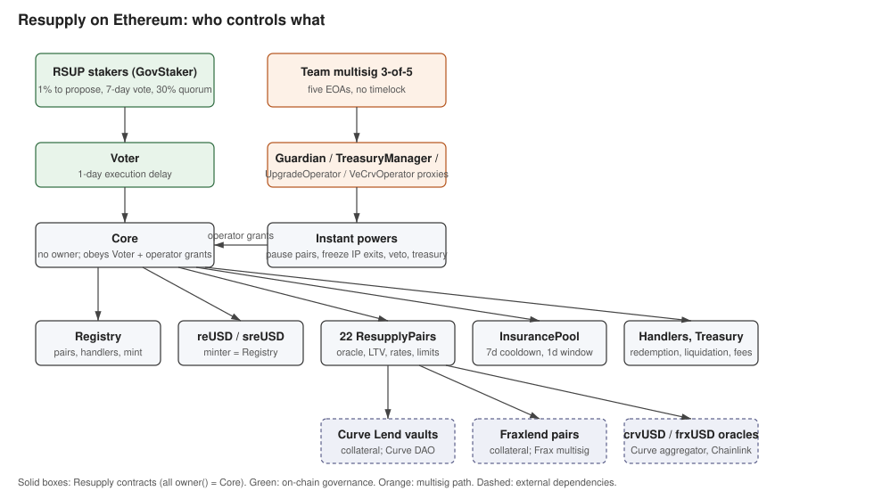

# Summary

Resupply is a CDP stablecoin protocol on Ethereum. Users deposit shares of external lending markets, Curve Lend vaults or Fraxlend pairs, as collateral into isolated `ResupplyPair` contracts and borrow reUSD against them. reUSD can be redeemed for collateral through a `RedemptionHandler`, staked into sreUSD, and is backstopped by an `InsurancePool` whose depositors absorb bad debt in exchange for protocol fees and RSUP emissions. Governance runs on-chain: RSUP stakers vote in a `Voter` contract that drives `Core`, the ownerless contract that owns every other protocol contract. A 3-of-5 team multisig holds a narrow set of emergency and treasury powers through operator contracts. Twenty-two pairs are registered today, eleven of which are retired with a zero borrow limit.

This review covers the Ethereum mainnet deployment as of 21 October 2026.

# Ratings

## Chain

Resupply is deployed on Ethereum mainnet only.

> Chain score: Low

## Upgradeability

None of the core contracts (Core, Voter, Registry, reUSD, sreUSD, pairs, handlers, InsurancePool, Treasury) is a proxy. Their behaviour is nonetheless fully permissioned through `Core`: governance can replace a pair's price oracle, maximum LTV and interest-rate calculator, swap any handler in the Registry, add minters to reUSD, change the InsurancePool withdrawal timers and fee splits, and register new pairs running new bytecode. Several of these can cause a direct _loss of user funds_: a replaced oracle or a lowered LTV makes healthy positions liquidatable, a hostile liquidation or redemption handler can seize collateral, and an added reUSD minter can issue unbacked debt against every holder. Governance can also appoint a new RSUP minter, so _unclaimed yield_ (emissions) is exposed as well.

All of these permissions are held by `Core` and can only be exercised through a passed proposal in the on-chain `Voter` (see [Governance](#governance)), or by an operator contract holding an explicit per-function grant from governance. The team multisig's grants are limited to emergency pauses (new borrows only), freezing InsurancePool withdrawals, vetoing proposals, revoking swapper approvals, toggling the redemption guard, a subset of Registry keys, treasury spending and the upgrade of two of its own operator proxies. The multisig cannot mint reUSD, move user collateral, change oracles, LTVs, rates or the Voter. Because permissions with loss-of-funds impact exist and are exercisable, the Upgradeability risk is High; the mitigation is assessed under Exit Window.

> Upgradeability score: High

## Autonomy

Every pair's collateral is a share of an external lending market, and that market's own admin can change its parameters, oracle and pause state. Curve Lend vaults are governed by the Curve DAO (on-chain governance with an ownership agent, Stage 1 equivalent); Fraxlend pairs are governed by a Frax multisig (the pair's `timelockAddress` and `owner` are the same Safe) and a separate circuit-breaker Safe, which is a centralized dependency. The collateral oracle used by all pairs, `BasicVaultOracle`, simply trusts the external vault's `convertToAssets`, so Resupply inherits the solvency and accounting of those markets one-to-one. The redemption path prices crvUSD through Curve's aggregator and frxUSD through a Chainlink feed read without a staleness check; a frozen Chainlink feed would mis-price frxUSD redemptions rather than halt them.

A failure of a Fraxlend market (parameter change, pause, bad debt) would be a loss for the pairs built on it, and that dependency has High centralization. The Curve Lend side is better governed, and bad debt is socialised to the InsurancePool rather than to borrowers in other pairs. On balance the Autonomy risk is Medium.

> Autonomy score: Medium

## Exit Window

Every permission that can cause a loss of funds requires a Voter proposal: 1% of staked RSUP to propose, a 7-day vote with a 30% quorum, then a 1-day execution delay, with a 3-week deadline after which the proposal expires. A user therefore sees at least 8 days between a proposal appearing on-chain and its execution. The vote period and delay are themselves governance parameters bounded to [1 day, 7 days] and [1 hour, 2 days], so governance could shorten the window to about 25 hours, but only through the same 8-day process.

The multisig's instant powers do not include anything that causes a loss of funds. Two of them can block funds: `pauseIPWithdrawals` sets the InsurancePool claim window to zero, freezing depositor exits until a vote reverses it, and pair pauses stop new borrows (repayments, withdrawals, redemptions and liquidations keep working). The multisig can also veto any pending proposal and, through `UpgradeOperator`, replace the implementation of its own Guardian proxy with no delay; a self-chosen implementation would drop the guard that keeps four sensitive Registry keys out of the Guardian's reach, which is the one escalation path we found (see Reviewer's Notes). The multisig does not meet the Security Council requirements (five insider EOAs, no public mapping to the four members named in the docs).

With an 8-day governance delay on every loss-of-funds permission, but below 30 days and with instant blocking powers in a 3-of-5 multisig, the Exit Window risk is Medium.

> Exit Window score: Medium

## Accessibility

Resupply is accessed through a single interface at resupply.fi. The frontend source is not published (the GitHub account holds the contracts, an airdrop repository and a brand kit), no backup interface is advertised, and we found no third-party interface integrating Resupply borrowing. The contracts can be used directly, but a user without technical means has no alternative if the interface goes down.

> Accessibility score: High

## Conclusion

Resupply achieves a Low Chain score, a High Upgradeability score mitigated by on-chain governance with an 8-day minimum delay (Medium Exit Window), a Medium Autonomy score from its Fraxlend and Chainlink dependencies, and a High Accessibility score for its single, closed-source interface. The upgradeability and exit-window combination satisfies the Stage 1 requirement; the missing frontend backup or self-hosting option does not. It thus ranks Stage 0.

The protocol would reach Stage 1 by publishing the frontend source or providing a backup interface.

Stage 2 would additionally require the exit window to be at least 30 days for loss-of-funds permissions (or the contracts to be immutable), the Fraxlend dependency to be mitigated or removed, and alternative third-party frontends to exist.

# Reviewer's Notes

⚠️ During our analysis we identified that the two operator proxies (Guardian and RedemptionOperator) can be upgraded by the team multisig without a vote. `UpgradeOperator` (manager: multisig) holds an `upgradeToAndCall` grant on both, granted at block 24506520, and the Guardian implementation was in fact replaced by a multisig transaction at block 24667986. The docs state that role proxies can only be upgraded by a governance vote, which is not accurate for these two. The practical escalation is limited: the Guardian proxy's grants are the ones listed under Operator permissions, and the implementation-level guard on four Registry keys (PAIR_DEPLOYER, VOTER, REUSD_ORACLE, EMISSIONS_CONTROLLER) and on `setMinTimeBetweenProposals` would not apply to a self-chosen implementation. The multisig still cannot mint reUSD, touch collateral or replace the Voter by this route.

⚠️ The docs describe the multisig as 3-of-4 with four named members; on-chain it is 3-of-5. The project's `deployment/contracts.json` lists a deprecated Voter address; the docs' contract-addresses page is correct and `Core.voter()` was used here.

The multisig held a direct `setVoter` grant on Core on two occasions in 2025 and early 2026; that grant was revoked at block 25782063 and reads false today. Proposal cancellation by the Guardian is itself revocable in a single vote that the code refuses to cancel.

Out of scope: the Curve and Frax governance systems behind the collateral markets, the Prisma legacy contracts now under Core, and the Curve pools and gauges holding reUSD liquidity.

# Protocol Analysis

`Core` is the ownership root: every protocol contract returns it as `owner()`. `Core.execute` runs an arbitrary call when the caller is the `Voter`, or when the caller holds an operator grant for that exact target and function selector set by a previous vote. The `Voter` is where RSUP stakers (weights from `GovStaker`, snapshotted one epoch back) create, vote on and execute proposals. `ResupplyRegistry` holds the list of pairs and the addresses of the handlers, and is the only minter of reUSD. Each `ResupplyPair` holds collateral shares, tracks debt, prices collateral through `BasicVaultOracle` and charges interest from `InterestRateCalculatorV2`. `RedemptionHandler` lets reUSD holders redeem against pair collateral, `LiquidationHandler` seizes collateral and burns `InsurancePool` reUSD against bad debt, `FeeDeposit` and `RewardHandler` distribute fees and RSUP emissions. The multisig acts only through four operator contracts (Guardian, TreasuryManager, UpgradeOperator, VeCrvOperator) whose grants are enumerated below.

# Dependencies

- Collateral markets: Curve Lend vaults (EIP-1167 clones of the Curve Lend vault, factory admin on the Curve DAO side) and Fraxlend pairs (owner and timelock = Frax Safe `0xb1748c79709f4ba2dd82834b8c82d4a505003f27`, circuit breaker Safe `0xfd3065c629ee890fd74f43b802c2fea4b7279b8c`). Their admins control the underlying markets' parameters, oracles and pauses.
- Debt assets: crvUSD (`0xf939E0A03FB07F59A73314E73794Be0E57ac1b4E`, Curve DAO) and frxUSD (`0xCAcd6fd266aF91b8AeD52aCCc382b4e165586E29`, transparent proxy controlled by Frax).
- Oracles: `BasicVaultOracle` (`0xa346ba5e838d6ee40204a69549c81ab982644150`, ownerless, reads `convertToAssets`), `UnderlyingOracle` (`0x152Ce2e248A86bd11Ca01502fb8feFBec0fbd5EC`, hard-coded Curve crvUSD aggregator `0x4DEcE678ceceb27446b35C672dC7d61F30bAD69E` and Chainlink frxUSD/USD proxy `0x9B4a96210bc8D9D55b1908B465D8B0de68B7fF83`, no staleness check), `ReusdOracle` (`0x3A1E320f289eeF2636B6D7Aa5C0f9202ee9928e4`, reads the reUSD Curve pools' EMA oracles).
- Liquidity and emissions: Curve StableSwap-NG pools and gauges for reUSD and RSUP, Convex staking of pair collateral, swap routers (Odos, LiFi, Enso) wrapped in Core-owned swapper contracts.

# Governance

## Voter parameters

Read from the Voter at `0x11111111063874cE8dC6232cb5C1C849359476E6` (32 proposals to date): voting period 604,800 s (7 days), execution delay 86,400 s (1 day), quorum 30% of staked weight, 1% of staked weight to create a proposal, one proposal per account per day, execution deadline 3 weeks after creation, simple majority. Period and delay are mutable by vote within [1 day, 7 days] and [1 hour, 2 days]; current values sit at the maximum of each range.

## Upgrade process

Core, Voter, Registry, pairs, handlers and the tokens are not proxies. A pair is "upgraded" by deploying a new pair (the multisig is an approved deployer), registering it through a vote (`PairAdder`, which is Core-only), and retiring the old one by pausing it; borrowers migrate themselves. The Voter is replaced by a vote calling `Core.setVoter`. The three role proxies are UUPS with `_authorizeUpgrade` restricted to Core, but see Reviewer's Notes for the multisig's upgrade grant on two of them.

## Emergency powers

The multisig, through the Guardian proxy, can instantly pause any or all pairs (new borrows only), freeze InsurancePool withdrawals, cancel or relabel any pending proposal, raise the per-account proposal cooldown, cancel borrow-limit ramps, revoke swapper approvals and toggle the redemption guard. Unpausing a pair and restoring InsurancePool withdrawals require a vote. Three single-pair pauses have been executed to date.

## Security Council

| Name | Account | Type | ≥ 7 signers | ≥ 51% threshold | ≥ 50% non-insider | Signers public |
| --- | --- | --- | --- | --- | --- | --- |
| Resupply multisig | [0xFE11a5009f2121622271e7dd0FD470264e076af6](https://etherscan.io/address/0xFE11a5009f2121622271e7dd0FD470264e076af6) | Multisig 3/5 | ❌ | ✅ | ❌ | ❌ (docs name four members; five on-chain signers, no mapping) |

# Contracts & Permissions

## Contracts

| Contract | Address |
|---|---|
| Core (ownership root, no owner) | [0xc07e000044F95655c11fda4cD37F70A94d7e0a7d](https://etherscan.io/address/0xc07e000044F95655c11fda4cD37F70A94d7e0a7d) |
| Voter (active) | [0x11111111063874cE8dC6232cb5C1C849359476E6](https://etherscan.io/address/0x11111111063874cE8dC6232cb5C1C849359476E6) |
| ResupplyRegistry | [0x10101010E0C3171D894B71B3400668aF311e7D94](https://etherscan.io/address/0x10101010E0C3171D894B71B3400668aF311e7D94) |
| Stablecoin reUSD | [0x57aB1E0003F623289CD798B1824Be09a793e4Bec](https://etherscan.io/address/0x57aB1E0003F623289CD798B1824Be09a793e4Bec) |
| SavingsReUSD sreUSD | [0x557AB1e003951A73c12D16F0fEA8490E39C33C35](https://etherscan.io/address/0x557AB1e003951A73c12D16F0fEA8490E39C33C35) |
| GovToken RSUP | [0x419905009e4656fdC02418C7Df35B1E61Ed5F726](https://etherscan.io/address/0x419905009e4656fdC02418C7Df35B1E61Ed5F726) |
| GovStaker | [0x22222222E9fE38F6f1FC8C61b25228adB4D8B953](https://etherscan.io/address/0x22222222E9fE38F6f1FC8C61b25228adB4D8B953) |
| VestManager | [0x6666666677B06CB55EbF802BB12f8876360f919c](https://etherscan.io/address/0x6666666677B06CB55EbF802BB12f8876360f919c) |
| EmissionsController | [0x33333333df05b0D52edD13D230461E5A0f5a4706](https://etherscan.io/address/0x33333333df05b0D52edD13D230461E5A0f5a4706) |
| Treasury | [0x4444444455bF42de586A88426E5412971eA48324](https://etherscan.io/address/0x4444444455bF42de586A88426E5412971eA48324) |
| InsurancePool | [0x00000000efe883b3304aFf71eaCf72Dbc3e1b577](https://etherscan.io/address/0x00000000efe883b3304aFf71eaCf72Dbc3e1b577) |
| RedemptionHandler | [0x5eeB063d0abefBBc78F576E28d762a16b637A025](https://etherscan.io/address/0x5eeB063d0abefBBc78F576E28d762a16b637A025) |
| LiquidationHandler | [0x88888888c227c36401493Ed9F3e3Dcc3800B2634](https://etherscan.io/address/0x88888888c227c36401493Ed9F3e3Dcc3800B2634) |
| RewardHandler | [0x74747408065d6A85DFf07D23F22C921Ce7D0b4B1](https://etherscan.io/address/0x74747408065d6A85DFf07D23F22C921Ce7D0b4B1) |
| FeeDeposit | [0x07Ad4630985ADe5B5307806C43E57e0A9A932C52](https://etherscan.io/address/0x07Ad4630985ADe5B5307806C43E57e0A9A932C52) |
| FeeDepositController | [0xC700000506423Bad12d5EB6D55b35EA9F5384Df6](https://etherscan.io/address/0xC700000506423Bad12d5EB6D55b35EA9F5384Df6) |
| ResupplyPairDeployer V2 | [0x5555555558B7309ecB0FbB23e609ec3c6f74C2Ea](https://etherscan.io/address/0x5555555558B7309ecB0FbB23e609ec3c6f74C2Ea) |
| PairAdder (operator) | [0x09500002956877b910ACEc25C4b4dd57950e1D27](https://etherscan.io/address/0x09500002956877b910ACEc25C4b4dd57950e1D27) |
| BorrowLimitController (operator) | [0x0950000465476F4470e74AeD93E7dd414012BB7D](https://etherscan.io/address/0x0950000465476F4470e74AeD93E7dd414012BB7D) |
| InterestRateCalculatorV2 (instance used by pairs) | [0xd3d5c6fc52f3bc29c3ab017d57d9a94a036ca90f](https://etherscan.io/address/0xd3d5c6fc52f3bc29c3ab017d57d9a94a036ca90f) |
| BasicVaultOracle (instance used by pairs) | [0xa346ba5e838d6ee40204a69549c81ab982644150](https://etherscan.io/address/0xa346ba5e838d6ee40204a69549c81ab982644150) |
| UnderlyingOracle | [0x152Ce2e248A86bd11Ca01502fb8feFBec0fbd5EC](https://etherscan.io/address/0x152Ce2e248A86bd11Ca01502fb8feFBec0fbd5EC) |
| ReusdOracle | [0x3A1E320f289eeF2636B6D7Aa5C0f9202ee9928e4](https://etherscan.io/address/0x3A1E320f289eeF2636B6D7Aa5C0f9202ee9928e4) |
| PriceWatcher | [0xAaaa0013e2ec451F76816d1e0a02ABA596dd9251](https://etherscan.io/address/0xAaaa0013e2ec451F76816d1e0a02ABA596dd9251) |
| Guardian operator proxy (ERC1967) | [0xA4745e0B1F40ab3DCFD98F381835De591a8974E3](https://etherscan.io/address/0xA4745e0B1F40ab3DCFD98F381835De591a8974E3) |
| TreasuryManager operator proxy (ERC1967) | [0x4CF97a55d58Aad14C493A46C8151a0BFffb10403](https://etherscan.io/address/0x4CF97a55d58Aad14C493A46C8151a0BFffb10403) |
| RedemptionOperator proxy (ERC1967) | [0x3F7C15d053Ab332D194D0040815E466d34387E40](https://etherscan.io/address/0x3F7C15d053Ab332D194D0040815E466d34387E40) |
| UpgradeOperator | [0x82ba27ee62Fc490f81feFCE5AC9C2f238F8b5543](https://etherscan.io/address/0x82ba27ee62Fc490f81feFCE5AC9C2f238F8b5543) |
| VeCrvOperator | [0x03E1538D33778C3711A075AF99FC75FCb31Ed341](https://etherscan.io/address/0x03E1538D33778C3711A075AF99FC75FCb31Ed341) |
| Keeper | [0x49F7AA38af55322dE009ADD5f10a602CD26Ee958](https://etherscan.io/address/0x49F7AA38af55322dE009ADD5f10a602CD26Ee958) |
| Representative pair: CurveLend crvUSD/wstETH | [0x4A7c64932d1ef0b4a2d430ea10184e3B87095E33](https://etherscan.io/address/0x4A7c64932d1ef0b4a2d430ea10184e3B87095E33) |
| Emission receivers (EIP-1167 clones of SimpleReceiver): Debt / InsurancePool / LiquidityIncentives / Retention | 0x70a1879aEeA28072E321d52427f0aC88603dF61b / 0x8b36aD6A6605745529908C90cCC90F05901155b4 / 0xC9a9C21F8740684129d271Ad1007E87E24858c59 / 0x6E7D5dade33f76F480EA38E3c47f870de74906F1 |
| Curve pools/gauges reUSD-scrvUSD, reUSD-sfrxUSD, WETH-RSUP | pools 0xc522A6606BBA746d7960404F22a3DB936B6F4F50, 0xed785Af60bEd688baa8990cD5c4166221599A441, 0xEe351f12EAE8C2B8B9d1B9BFd3c5dd565234578d; gauges 0xaF01d68714E7eA67f43f08b5947e367126B889b1, 0x5C0B03914f68F2717d779a0211fd98C2CC45a4dD, 0x09F62a6777032329C0d49F1FD4fBe9b3468CDa56 (Curve-owned) |

Registry holds 22 pairs (`registeredPairsLength()` = 22), eight more than contracts.json lists (sUSDS, tBTC-2, wstUSR, fxSAVE, sreUSD, and CurveLendV2 sDOLA/sfrxUSD/syrupUSDC). Eleven of the 22 currently have `borrowLimit` = 0 (paused/retired). All pairs are plain contracts (no proxy), all verified.

Deprecated, still deployed: Voter 0x11111111084a560ea5755Ed904a57e5411888C28, Voter 0x11111111408bd67B92C4f74B9D3cF96f1fa412BC, Voter 0x111111110d3e18e73CC2227A40B565043266DaC1; PairDeployer V1 0x5555555524De7C56C1B20128dbEAace47d2C0417; FeeDepositController old 0x7E3D2F480AbbA95863040D763DDe8F30D100C6F5; RewardHandler old 0xdBF41092e1E310a2B48B0895095EfF6d341D8F00; InterestRateCalculator v1 0x77777777729C405efB6Ac823493e6111F0070D67; BasicVaultOracle 0xcb7E25fbbd8aFE4ce73D7Dac647dbC3D847F3c82 (contracts.json key, not the instance pairs use); Guardian old 0x0950000dd946D519B53424830075364e90B7eFB1 and TreasuryManager old 0x09500006956d172973138a5b38CFcd2277552BB9 (all Core grants revoked); pairs sDOLA-1, tBTC-1, frxUSD/WBTC-1. Old Voters have no power: `Core.execute` only honours `msg.sender == voter`.

## All Permission Owners

| Name | Address | Type |
|---|---|---|
| Core | 0xc07e000044F95655c11fda4cD37F70A94d7e0a7d | Contract (no owner; executes for Voter or operators) |
| Voter | 0x11111111063874cE8dC6232cb5C1C849359476E6 | Governance (RSUP stakers via GovStaker) |
| Resupply multisig | 0xFE11a5009f2121622271e7dd0FD470264e076af6 | Multisig 3/5 (Safe). Signers: 0x4d1b56274c01481c0312fca332016d83512beee3, 0xbd0a74e51729a4d0b92742e67183c4cbc97bca92, 0x1101c94c6001e4074ad4dbad5ad08117979ca9d4, 0x1b1d2806de441eaaac7f6677bd15dfa937a5b97c, 0xaac0aa431c237c2c0b5f041c8e59b3f1a43ac78f (all EOAs) |
| Guardian proxy | 0xA4745e0B1F40ab3DCFD98F381835De591a8974E3 | Contract; `guardian()` = multisig; impl 0x74C85620F1459862834A947dB9441911BCEBF066 |
| TreasuryManager proxy | 0x4CF97a55d58Aad14C493A46C8151a0BFffb10403 | Contract; `manager()` = multisig; impl 0x249f28538e01af803f3803b837344a4f411f6db1 |
| RedemptionOperator proxy | 0x3F7C15d053Ab332D194D0040815E466d34387E40 | Contract; `manager()` = multisig; approved callers multisig, 0x1ba323f8a6544b81dc1f068b1400a6ebe7ea0f52, 0x051c42ee7a529410a10e5ec11b9e9b8ba7cbb795; impl 0x6b7cde3f1bced8e4cb7150ba47e20be71436d8a4 |
| UpgradeOperator | 0x82ba27ee62Fc490f81feFCE5AC9C2f238F8b5543 | Contract; `manager()` = multisig |
| VeCrvOperator | 0x03E1538D33778C3711A075AF99FC75FCb31Ed341 | Contract; `manager()` = multisig |
| PairAdder, BorrowLimitController | 0x09500002956877b910ACEc25C4b4dd57950e1D27, 0x0950000465476F4470e74AeD93E7dd414012BB7D | Contract; owner Core (only governance can drive them) |
| Registry | 0x10101010E0C3171D894B71B3400668aF311e7D94 | Contract; sole reUSD mint operator |
| Keeper owner | 0xe5BcBdf9452af0AB4b042D9d8a3c1E527E26419f | EOA (deployer; owns Keeper, which only triggers permissionless upkeep) |
| Curve Lend factory admin | 0xb7400d2ea0f6dc1d7b153aa430b9e572f28afb79 | Contract (Vyper; Curve DAO side, not verified further) |
| Frax timelock / circuit breaker | 0xb1748c79709f4ba2dd82834b8c82d4a505003f27 / 0xfd3065c629ee890fd74f43b802c2fea4b7279b8c | Multisig (Safe proxies; Frax side, thresholds not read) |

Every protocol contract queried (`owner()` on Registry, Stablecoin, InsurancePool, pairs, sreUSD, GovStaker, Treasury, FeeDeposit, handlers, GovToken, VestManager, EmissionsController, PriceWatcher, PairDeployer, RewardHandler, FeeDepositController, IRC V2, PairAdder, BorrowLimitController) returns Core. The three oracles have no owner function at all.

## Permissions

"Owner = Core" means callable only through `Core.execute`, i.e. by a passed Voter proposal or by an operator holding a matching grant (see next section). Multisig-reachable rows are marked.

| Contract | Function | Impact | Owner |
|---|---|---|---|
| Core | `setOperatorPermissions(caller,target,selector,authorized,hook)` | Grants or revokes a caller's right to run one selector on one target (or any target) through Core, optionally with a pre/post hook. This is the whole delegation model: every multisig power below exists only as such a grant. A malicious grant hands arbitrary ownership powers (mint, treasury drain, oracle swap) to any address without a further vote. | Core (vote) |
| Core | `setVoter(address)` | Replaces the governance contract that Core obeys unconditionally. It is the system's root key. A hostile voter would own every contract and all user collateral/fees. | Core (vote); multisig held a direct grant until block 25782063, now revoked |
| Core | `execute(target,data)` | Runs any call from Core's context. Voter uses it for every proposal payload. Operators are limited per selector; the Voter is not. | Voter, operators |
| Voter | `setQuorumPct`, `setMinCreateProposalPct`, `setVotingPeriod` (>1d, <=7d), `setExecutionDelay` (>1h, <=2d), `setMinTimeBetweenProposals` | Tune governance parameters. They bound how fast and by whom a proposal can pass. Shrinking period/delay to 1d/1h would cut the effective exit window to ~25h; raising the proposal threshold can lock out small holders. | Core; `setMinTimeBetweenProposals` also multisig via Guardian |
| Voter | `cancelProposal(id)`, `updateProposalDescription` | Marks a pending proposal processed so it can never execute / rewrites its text. Intended veto on malicious proposals. Abuse blocks all governance except a single-action proposal that revokes the canceler's `cancelProposal` grant, which the code refuses to cancel. | Core; multisig via Guardian |
| ResupplyPair (all 22, identical) | `pause()` / `unpause()` | Sets `borrowLimit` to 0 / restores previous. Stops new borrows and leverage only; repay, collateral withdrawal, redemption, liquidation keep working. Malicious pause freezes new credit and (via `currentUtilization`=100%) distorts UI, but cannot trap funds. | Core; `pause()` also multisig via Guardian (global grant) |
| ResupplyPair | `setBorrowLimit(uint)` | Caps total debt per pair. Governs reUSD supply growth. Lowering below outstanding debt blocks new borrows; raising recklessly expands exposure to a bad collateral. | Core; ramp-up via BorrowLimitController (global grant, Core-driven, >=7 days per ramp) |
| ResupplyPair | `setOracle(address)` | Swaps the collateral price source (currently BasicVaultOracle 0xa346..., which reads ERC-4626 `convertToAssets`). All LTV and liquidation maths depend on it. A manipulated oracle lets positions be liquidated or borrowed against incorrectly, directly draining borrowers or leaving bad debt for the InsurancePool. | Core |
| ResupplyPair | `setMaxLTV(uint)` | Changes the solvency threshold (wstETH pair: 95,000/100,000). A sudden cut can make healthy positions liquidatable; a rise lets undercollateralised debt be minted. | Core |
| ResupplyPair | `setRateCalculator(address,bool)` | Points interest to a new calculator (currently IRC V2 0xd3d5..., deriving from the underlying lend market rate, not utilisation). A hostile calculator can charge arbitrary interest, i.e. confiscate collateral over time. | Core |
| ResupplyPair | `setProtocolRedemptionFee`, `setMinimumRedemption`, `setMinimumLeftoverDebt`, `setMinimumBorrowAmount` | Redemption fee split and dust limits. Fees flow to FeeDeposit; minimums gate who can redeem/borrow. Extreme values make redemption uneconomic (weakens the peg) or block small users. | Core |
| ResupplyPair | `setSwapper(address,bool)`, `setConvexPool(pid)` | Whitelists swap routers for leverage/deleverage; moves collateral staking to a Convex pool. A malicious swapper can skim users' leverage flows; a wrong pid strands staked collateral rewards. | Core or Registry (swappers); Core (pid) |
| ResupplyPairDeployer | `deploy`, `deployWithDefaultConfig` | Creates new pair contracts (not registered until `Registry.addPair`). Unregistered pairs cannot mint reUSD. Low impact alone; the multisig is an approved deployer. | Core or approved deployers (multisig since block 23133919) |
| ResupplyPairDeployer | `setCreationCode`, `setApprovedDeployer`, config setters | Changes the bytecode future pairs run and who may deploy. Combined with `addPair` it defines what code can mint reUSD. Malicious bytecode would let a pair mint unbacked reUSD. | Core |
| Registry | `addPair(address)` | Registers a pair, enabling `Registry.mint` -> reUSD mint for it. Only path to new credit lines. A rogue pair could mint unbacked reUSD. | Core; PairAdder (itself Core-only, checks trusted deployer) |
| Registry | `setLiquidationHandler/FeeDeposit/RedemptionHandler/InsurancePool/RewardHandler/Staker/Treasury/VestManager/L2Manager` | Replaces protected system components. All pairs resolve handlers via the Registry at call time. A hostile handler can seize liquidated collateral, redirect fees, or break redemptions. | Core |
| Registry | `setAddress(string,address)` | Sets non-protected keys (VOTER, PAIR_DEPLOYER, REUSD_ORACLE, EMISSIONS_CONTROLLER, GUARDIAN, SWAPPER_*, PRICE_WATCHER, SREUSD, REDEMPTION_OPERATOR, ...). These feed PairAdder checks, the redemption guard and leverage routing. The Guardian implementation refuses PAIR_DEPLOYER, VOTER, EMISSIONS_CONTROLLER, REUSD_ORACLE, but that guard lives in the upgradeable implementation, not in Registry. | Core; multisig via Guardian for unguarded keys |
| Registry | `withdrawTo(asset,amount,to)`, `setDefaultSwappers` | Sweeps tokens held by Registry; sets swappers pushed to pairs. Minor treasury-like exposure. | Core |
| Stablecoin reUSD | `setOperator(address,bool)`, `mint` | Minters are owner plus operators; the only operator is Registry (event at block 22034895). Core could add itself or anyone as minter. Unbacked minting breaks the peg for all holders. | Core |
| InsurancePool | `setWithdrawTimers(len, window)` (len <= MAX_WITHDRAW_DELAY) | Sets the exit cooldown (now 7d+1s) and claim window (now 1d+1s). Withdrawals require `exitTime <= now <= exitTime+window`. Window = 0 blocks every withdrawal indefinitely; Guardian's `pauseIPWithdrawals` does exactly this. | Core; multisig via Guardian |
| InsurancePool | `setMinimumHeldAssets`, `burnAssets` (by LiquidationHandler) | Floor on assets protected from bad-debt burns; burn socialises bad debt to depositors. Depositors bear losses by design; a tiny floor with a hostile handler can wipe the pool. | Core / LiquidationHandler |
| RedemptionHandler | `setBaseRedemptionFee`, `setDiscountInfo`, `setOverusageInfo`, `setWeightLimit`, `setUnderlyingOracle`, `updateGuardSettings` | Fee curve, per-pair redemption weighting, the crvUSD/frxUSD oracle, and the guard that limits who can redeem below a reUSD price threshold (currently enabled). Redemptions are the peg backstop and burn borrowers' collateral. Wrong oracle or fees let redeemers overpay or underpay borrowers; disabling the guard opens MEV redemptions, a huge weight limit concentrates redemptions on one pair. | Core; `updateGuardSettings` also multisig via Guardian |
| LiquidationHandler | `setLiquidationIncentive`, `distributeCollateralAndClearDebt` | Liquidator bonus; and the step that burns InsurancePool reUSD against recorded bad debt and hands it the seized collateral. Misuse over/under-rewards liquidators or burns pool assets. | Core |
| RewardHandler | `setBaseMinimumWeight`, `setPairMinimumWeight`, `migrateState` | Weights deciding how RSUP emissions split across pairs/IP/stakers. Can starve a pair's borrowers of rewards. Does not touch principal. | Core |
| FeeDeposit / FeeDepositController | `setOperator`; `setSplits(insurance, treasury, platform, stakedStable)`, `setAdditionalFeeRatio` | Operator receives all weekly protocol fees; splits route them to IP, Treasury, stakers, sreUSD. A hostile operator or 100% treasury split diverts all fee yield from users. | Core |
| InterestRateCalculatorV2 | `setRateInfo(base, baseCollateral)` (<100%) | Multipliers over the underlying market rate for all pairs using it. Raises/lowers every borrower's interest at once. Bounded below 100% APR. | Core |
| sreUSD | `setMaxDistributionPerSecondPerAsset` | Caps yield streamed to sreUSD holders. Setting 0 halts yield (funds stay withdrawable). | Core |
| EmissionsController / GovToken | `setReceiverWeights`, `registerReceiver`, `(de)activateReceiver`, `setEmissionsSchedule`, `recoverUnallocated`; `setMinter`, `finalizeMinter` | RSUP inflation schedule and recipients; GovToken minter is EmissionsController and `minterFinalized` is false, so Core could appoint another minter. Changing weights redirects unclaimed emissions; an arbitrary minter dilutes RSUP without bound. | Core |
| GovStaker / VestManager | `setCooldownEpochs` (<= MAX); `setLockPenaltyMerkleRoot`, `setInitializationParams` (one-shot) | Unstake cooldown (now 2 epochs = 14d); airdrop roots. Longer cooldown delays exit from governance stake; a wrong root misallocates vesting RSUP. | Core |
| Treasury | `retrieveToken(Exact)`, `retrieveETH(Exact)`, `setTokenApproval`, `execute`, `safeExecute` | Moves any token/ETH out of the Treasury or makes arbitrary calls from it. Treasury holds protocol-owned assets, not user deposits. Full discretionary drain by the manager. | Core; multisig via TreasuryManager (all six selectors granted) |
| Guardian proxy | `pausePair`, `pauseAllPairs`, `cancelProposal`, `updateProposalDescription`, `setRegistryAddress`, `revokeSwapperApprovals`, `pauseIPWithdrawals`, `cancelRamp`, `updateRedemptionGuardSettings`, `recoverERC20` | Wrappers that call Core.execute with the proxy's grants. Emergency brake: used at blocks 24362983, 24384228, 24667972 to pause single pairs. All instant, no vote. | multisig (`guardian`); `setGuardian`, `setGuardedRegistryKey`, upgrade: Core |
| TreasuryManager proxy | the Treasury wrappers above plus `transferTokenFromPrismaFeeReceiver`, `approveTokenFromPrismaFeeReceiver`, `claimLpIncentives(To)`, `setLpIncentivesReceiver` | Spends Treasury and legacy Prisma fee-receiver (0xfdCE0267803C6a0D209D3721d2f01Fd618e9CBF8) balances and claims LP emissions. Vote-incentive operations. Drain of protocol-owned funds only. | multisig (`manager`); `setManager`, upgrade: Core |
| UpgradeOperator | `upgradeToAndCall(target, impl, data)` | Calls Core.execute to upgrade a proxy. Granted for Guardian and RedemptionOperator proxies. A malicious Guardian implementation inherits every Guardian grant without the implementation's own checks (e.g. guarded registry keys, see Governance). | Core or multisig (`manager`) |
| RedemptionOperator proxy | `executeRedemption` (flash-loan arbitrage redemptions); `setApprovals`, `revokeAllApprovals`, `setApprovedCaller`, `sweep`, `approveRH` | Runs peg-defence redemptions with protocol funds and keeps profits in the operator. Sweep moves held tokens anywhere. Exposure limited to the operator's balance. | approved callers / multisig; `setManager`, upgrade: Core |
| VeCrvOperator | `claimFees`, `delegateBoost`, `extendLock`, `setBoostShare`, `setReceiver`, `voteInCurveDao`, `voteForGaugeWeights` | Drives the inherited Prisma veCRV voter proxy (0x490b8C6007fFa5d3728A49c2ee199e51f05D2F7e). Curve gauge votes and fee claims. Misdirected fees/votes; no user funds. | Core or multisig |
| Keeper | `setOwner`, `setOperators`, `setBorrowLimitUpdateInterval`; `work()` permissionless | Automation that calls only permissionless functions (fee distribution, borrow-limit ramp updates, swapper approvals). Owner can stop upkeep; no privileged access. | EOA 0xe5Bc... |
| SimpleReceiver clones / SimpleReceiverFactory / RetentionReceiver | `claimEmissions`, `setApprovedClaimer`; `setImplementation`; `setTreasuryAllocationPerEpoch`, `sweepERC20` | Pulls allocated RSUP emissions to a target; sets clone code; retention split. Unclaimed emissions can be redirected. | Core (plus approved claimers; TreasuryManager for LP receiver) |
| CurveLendMinterFactory / CurveLendOperator | `addMarketOperator`, `removeMarketOperator`, `setImplementation`, `setFeeReceiver`; `setMintLimit` | crvUSD minting facility: Curve-side owner 0x40907540d8a6c65c637785e8f8b742ae6b0b9968 (Curve DAO ownership agent, Aragon proxy) sets which markets may borrow crvUSD. Not Resupply-controlled. | Curve DAO |

## Operator permissions on Core

Reconstructed from all 86 `OperatorSet(caller, target, authorized, selector, hook)` events on Core (Blockscout logs, topic `0xea1c80a5...`), keeping the last value per (caller, target, selector). No grant uses an auth hook. Current state:

| Caller | Target | Selectors | Effective holder |
|---|---|---|---|
| Guardian proxy 0xA474... | any (0x0) | `pause()`, `cancelProposal(uint256)`, `updateProposalDescription(uint256,string)`, `setMinTimeBetweenProposals(uint256)`, `cancelRamp(address)`, `revokeApprovals()`, `updateGuardSettings(bool,uint256)` | multisig, instant |
| Guardian proxy | Registry | `setAddress(string,address)` | multisig (impl blocks 4 keys) |
| Guardian proxy | InsurancePool | `setWithdrawTimers(uint256,uint256)` | multisig |
| TreasuryManager proxy 0x4CF9... | Treasury | `retrieveToken`, `retrieveTokenExact`, `retrieveETH`, `retrieveETHExact`, `setTokenApproval`, `execute`, `safeExecute` | multisig |
| TreasuryManager proxy | Prisma FeeReceiver 0xfdCE... | `transferToken(address,address,uint256)`, `setTokenApproval` | multisig |
| UpgradeOperator 0x82ba... | Guardian proxy, RedemptionOperator proxy | `upgradeToAndCall(address,bytes)` | multisig |
| VeCrvOperator 0x03E1... | Prisma VoterProxy 0x490b... | `execute(address,bytes)` | multisig |
| BorrowLimitController 0x0950...7D | any | `setBorrowLimit(uint256)` | nobody without a vote (its own setters are Core-only; `updatePairBorrowLimit` ramps are permissionless once set) |
| PairAdder 0x0950...27 | Registry | `addPair(address)` | nobody without a vote (`addPair` is Core-only) |

Revoked history worth recording: the multisig itself held `setVoter` on Core (blocks 22034895 to 22133126 and again 23225032 to 25782063), direct Treasury drain selectors (until 22133126), `setLockPenaltyMerkleRoot` on VestManager, and `cancelProposal` on the first Voter; all are now 0. `operatorPermissions(multisig, Core, 0x4bc2a657)` reads false today.

Who can act with no vote today: the multisig, through the Guardian proxy (pause any pair, block InsurancePool withdrawals, cancel/relabel any proposal, raise the per-account proposal cooldown, cancel borrow-limit ramps, revoke swapper approvals, flip the redemption guard, rewrite unguarded Registry keys), through the TreasuryManager proxy (spend the Treasury and Prisma fee receiver), through UpgradeOperator (replace the Guardian and RedemptionOperator implementations), and through VeCrvOperator (Curve votes). Two bot EOAs can only trigger redemption arbitrage.
